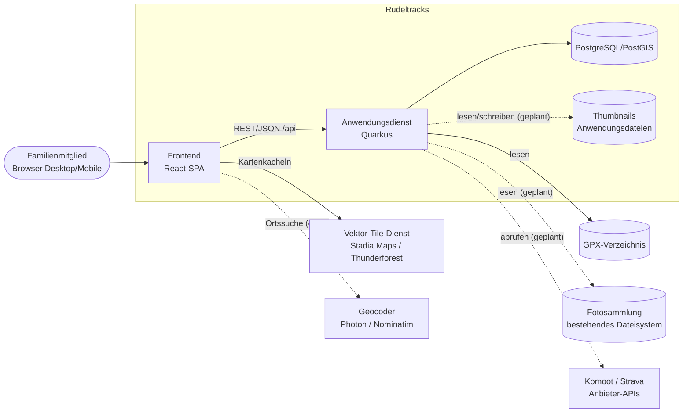
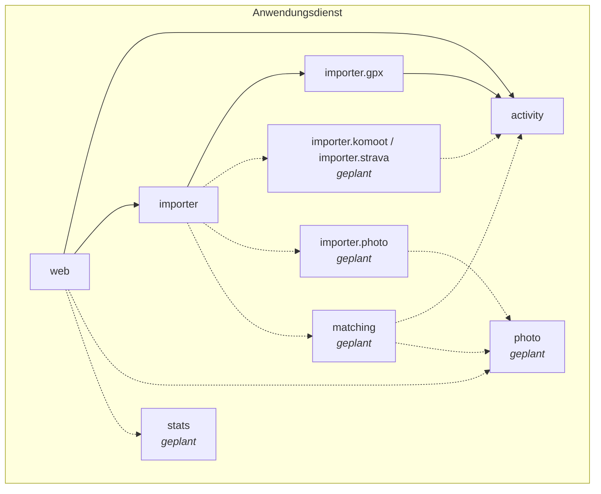

# 5. Bausteinsicht

**Stand:** Entwurf für den Walking Skeleton. Bausteine, die erst mit späteren
Features entstehen, sind als *geplant* gekennzeichnet. Begriffe wie Aktivität,
Track und Quelle siehe [Glossar](12-glossar.md).

## Ebene 1: Gesamtsystem

| Baustein | Verantwortung |
|---|---|
| Frontend | Kartenansicht, Filter, Aktivitätsliste, Detailansicht; läuft vollständig im Browser ([ADR-006](adr/adr-006-frontend-techstack.md)) |
| Anwendungsdienst | Liefert das gebaute Frontend und die API aus, führt Importläufe aus, kapselt Datenbank, Dateisystem und Anbieter-APIs ([ADR-004](adr/adr-004-frontend-backend-aufteilung.md), [ADR-007](adr/adr-007-backend-techstack.md)) |
| PostgreSQL/PostGIS | Quellen, Aktivitäten, Tracks, Foto-Metadaten, Zuordnungen, Importprotokoll ([ADR-003](adr/adr-003-persistenz.md), [Datenmodell](../implementation/data_model.md)) |
| Thumbnails | Generierte Bildvarianten (geplant, [ADR-001](adr/adr-001-bildauslieferung.md)) |

Externe Nachbarn: GPX-Verzeichnis und Fotosammlung werden nur gelesen. Die
Anbieter-APIs von Komoot und Strava sind als spätere Quellen für Aktivitäten
vorgesehen. Kartenkacheln lädt der Browser direkt beim Tile-Dienst
([ADR-002](adr/adr-002-kartenkacheln.md)). Ob die Ortssuche direkt oder über
das Backend läuft, ist offen.

Schnittstelle Frontend ↔ Anwendungsdienst: siehe [API-Skizze](../implementation/api.md)
und [ADR-008](adr/adr-008-api-vertrag.md).

## Ebene 2: Fachliche und technische Bausteine

### Anwendungsdienst

| Baustein | Verantwortung | Features |
|---|---|---|
| `web` | Auslieferung der SPA inkl. Fallback auf `index.html`, OpenAPI-Spezifikation, einheitliche Fehlerantworten, Caching-Header | – |
| `activity` | Aktivitätskatalog: Suche und Filter, Detaildaten, Tracks je Generalisierungsstufe, Aktivitätsarten | RTCS-03, 05, 06, 07, 09 |
| `importer` | Steuerung der Importläufe je Quelle: Auslösung (Start, Zeitplan, manuell), Auflisten der Quellobjekte, Änderungserkennung über `source_item`, Protokoll, Sperre gegen parallele Läufe derselben Quelle | RTCS-19 |
| `importer.gpx` | GPX parsen, Aktivität anlegen/aktualisieren, Kennzahlen und Generalisierungsstufen berechnen | RTCS-16 |
| `importer.komoot`, `importer.strava` (geplant) | Abruf über die Anbieter-APIs, Autorisierung, Umwandlung in Aktivitäten | – |
| `importer.photo` (geplant) | EXIF lesen, Fotos anlegen, Thumbnails erzeugen | RTCS-17 |
| `matching` (geplant) | Foto-Aktivitäts-Zuordnung mit Konfidenz | RTCS-18 |
| `photo` (geplant) | Foto-Katalog und Bildauslieferung | RTCS-08, 10, 11 |
| `stats` (geplant) | Kennzahlen für das Dashboard | RTCS-02 |

Regeln:

- `importer` kennt nur Quellen und Quellobjekte. Was ein Quellobjekt enthält,
  verarbeitet der zur Quellart passende Unterbaustein (`importer.gpx`,
  später `importer.komoot` usw.). Neue Quellarten kommen so ohne Änderung an
  Ablauf, Änderungserkennung und Protokoll hinzu.
- Nur `importer.*` und `matching` schreiben Fachdaten; `activity`, `photo` und
  `stats` lesen ausschließlich.
- REST-Ressourcen liegen im jeweiligen Fachbaustein; `web` enthält nur
  Querschnittliches.

### Frontend

| Baustein | Verantwortung | Features |
|---|---|---|
| `api` | Von Orval generierte Typen und Query-Hooks; nicht manuell bearbeitet ([ADR-008](adr/adr-008-api-vertrag.md)) | – |
| `routes` | Routen und typisierte Suchparameter (Filter, ausgewählte Aktivität, Kartenausschnitt) | – |
| `map` | MapLibre-Karte, Track-Ebene (Kartenstufe, ausgewählte Aktivität in voller Auflösung), Hervorhebung, Cluster-Ebene | RTCS-01, 05, 07 |
| `filter` | Filterleiste, aktive Filter, Synchronisation mit der URL | RTCS-03 |
| `activity-list` | Virtualisierte Trefferliste, Sichtbarkeitssteuerung | RTCS-06 |
| `activity-detail` | Detailpanel, Höhenprofil | RTCS-09 |
| `photos` (geplant) | Foto-Marker, Galerie, Lightbox, Konfidenzfilter | RTCS-08, 10, 11 |
| `dashboard` (geplant) | Einstiegsseite mit Kennzahlen | RTCS-02 |

Zustand nach [ADR-006](adr/adr-006-frontend-techstack.md): Filter und Auswahl in
der URL, Serverdaten in TanStack Query, Kartenzustand (Zoom, Ausschnitt) in der
MapLibre-Instanz. Der Ausschnittsfilter wird im Frontend auf die geladene
Aktivitätsliste angewendet
([Auslieferung](../implementation/activities.md#auslieferung-an-die-karte)).

## Ebene 3: Details ausgewählter Bausteine

Noch nicht ausgearbeitet. Kandidat ist `importer` (Ablauf eines inkrementellen
Laufs), sobald der Skeleton steht.
