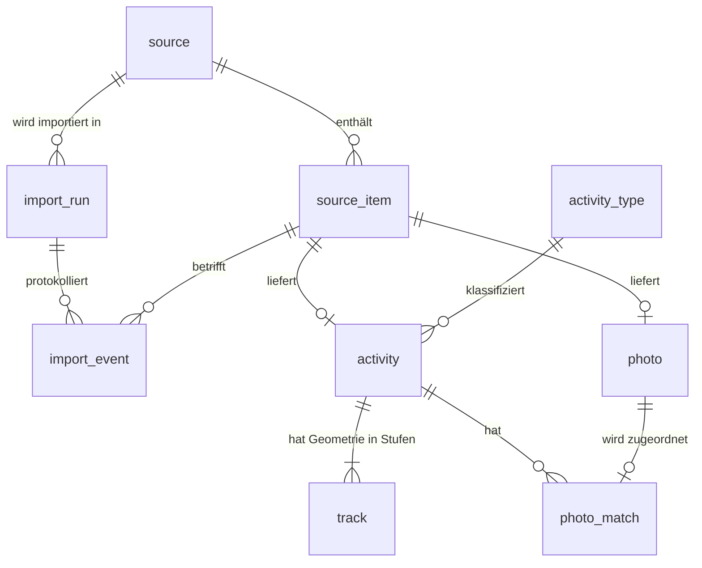

# Datenmodell

**Status:** Entwurf für den Walking Skeleton (14.11.2026)

Grundlage: [ADR-003 Persistenz](../architecture/adr/adr-003-persistenz.md)
(PostgreSQL/PostGIS). Das Modell deckt den Walking Skeleton (GPX-Import,
Aktivitätssuche, Karte) vollständig ab. Fotos, Matching und Importläufe sind
skizziert, damit der Skeleton keine Entscheidungen verbaut; sie werden mit den
jeweiligen Features verfeinert. Personen ([RTCS-20](../requirements/RTCS-20-participants.md))
und Nutzerprofile ([RTCS-15](../requirements/RTCS-15-user-profiles.md)) sind
Phase 2 und nicht enthalten.

## Begriffe

- **Aktivität** (`activity`): eine Unternehmung wie eine Wanderung oder
  Radtour, mit Name, Zeitraum, Art und Kennzahlen.
- **Track** (`track`): die aufgezeichnete Geometrie einer Aktivität, also die
  GPS-Punkte mit Höhe und Zeit. Eine Aktivität hat genau einen Track, der in
  mehreren Auflösungsstufen gespeichert wird.
- **Quelle** (`source`): ein konfigurierter Ursprung von Daten, z. B. ein
  GPX-Verzeichnis, ein Fotoverzeichnis oder später ein Komoot- oder
  Strava-Konto.
- **Quellobjekt** (`source_item`): eine einzeln abrufbare Einheit einer Quelle,
  z. B. eine Datei im Verzeichnis oder eine Tour in der Komoot-API.

Siehe auch [Glossar](../architecture/12-glossar.md).

## Überblick

## Konventionen

- Koordinaten in WGS 84 (`SRID 4326`), Reihenfolge Länge/Breite wie in GeoJSON.
- Zeitpunkte als `timestamptz` (UTC). Lokale Zeiten nur dort, wo die Quelle
  keinen Offset liefert (EXIF), siehe [Fotos](#photo-skizze).
- Längen in Metern, Dauern in Sekunden.
- Technische Primärschlüssel als `uuid`. Sie werden beim ersten Import vergeben
  und bleiben über Wiederholungsläufe stabil, weil die Zuordnung über einen
  fachlichen Schlüssel erfolgt (siehe `activity.source_key`). Dadurch bleiben
  auch Links mit Aktivitäts-ID in der URL gültig.
- Schema-Migrationen über Flyway (Quarkus-Erweiterung).

## Quellen und Importprotokoll

### `source`

Konfigurierte Datenquelle. Im Skeleton gibt es genau eine Quelle der Art
`directory` für GPX-Dateien. Weitere Arten kommen mit den
[API-Importen](activities.md#ausblick-api-import) hinzu.

| Spalte | Typ | Bemerkung |
|---|---|---|
| `id` | `uuid` PK | |
| `kind` | `text` | `directory`; später `komoot`, `strava` |
| `content` | `text` | Was die Quelle liefert: `activity` oder `photo` |
| `name` | `text` | Anzeigename, z. B. „GPX-Archiv“ |
| `config` | `jsonb` | art-spezifisch, z. B. `{"path": "/data/gpx", "pattern": "*.gpx"}` |
| `enabled` | `boolean` | |

Zugangsdaten für API-Quellen gehören nicht in `config`. Wo sie abgelegt werden,
wird mit der Prüfung der Komoot- und Strava-APIs entschieden.

### `source_item`

Ein Quellobjekt. Grundlage für Änderungserkennung und Idempotenz
([RTCS-19](../requirements/RTCS-19-incremental-sync.md)), unabhängig davon, ob
die Quelle ein Verzeichnis oder eine API ist.

| Spalte | Typ | Bemerkung |
|---|---|---|
| `id` | `uuid` PK | |
| `source_id` | `uuid` FK | |
| `item_key` | `text` | Schlüssel innerhalb der Quelle; eindeutig zusammen mit `source_id` |
| `revision` | `text` | Änderungsmerkmal, das ohne Abruf des Inhalts verfügbar ist |
| `content_hash` | `text` | SHA-256 des abgerufenen Inhalts |
| `status` | `text` | `ok`, `error`, `removed` |
| `error_message` | `text` | letzte Fehlermeldung bei `status = 'error'` |
| `first_seen_at` / `last_seen_at` | `timestamptz` | |

Belegung je Quellart:

| Quellart | `item_key` | `revision` |
|---|---|---|
| `directory` | Pfad relativ zum Quellverzeichnis | Größe und mtime, z. B. `449801@2026-01-03T10:12:00Z` |
| `komoot` (später) | Tour-ID | Änderungszeitpunkt aus der API, falls vorhanden |
| `strava` (später) | Activity-ID | dto. |

Änderungserkennung: `revision` unverändert → überspringen. Sonst Inhalt
abrufen und Hash berechnen; Hash unverändert → nur `revision` aktualisieren.
Quellobjekte, die im Lauf nicht mehr gefunden werden, erhalten
`status = 'removed'`. Ihre Aktivitäten werden nicht gelöscht, sondern
ausgeblendet (`activity.hidden`).

### `import_run` und `import_event`

Protokoll der Importläufe ([RTCS-19](../requirements/RTCS-19-incremental-sync.md)).

`import_run`: `id`, `source_id` (`NULL` beim Foto-Matching), `kind`
(`import`, `match`), `trigger` (`startup`, `schedule`, `manual`, `watcher`),
`started_at`, `finished_at`, `status` (`running`, `ok`, `failed`), Zähler
`items_new`, `items_changed`, `items_unchanged`, `items_removed`,
`items_failed`.

`import_event`: `id`, `run_id`, `source_item_id`, `action` (`new`, `changed`,
`removed`, `error`), `message`, `created_at`. Unveränderte Quellobjekte
erzeugen keine Events, damit das Protokoll bei 10.000 Fotos klein bleibt.

Der Zeitpunkt des letzten Laufs mit Änderungen dient außerdem als Datenstand
für HTTP-Caching (siehe [API](api.md#caching)).

## Aktivitäten

### `activity_type`

Stammdaten der Aktivitätsarten. Komoot-Webexporte liefern sie in
`<trk><type>` (z. B. `hike`); weitere Werte werden beim Import automatisch
angelegt.

| Spalte | Typ | Bemerkung |
|---|---|---|
| `code` | `text` PK | Wert aus der Quelle, z. B. `hike`, `racebike`, `mtb`; `unknown`, wenn die Quelle keine Art liefert |
| `label` | `text` | Anzeigename, z. B. „Wandern“; Default = `code` |
| `category` | `text` | Grobe Gruppe für Filter und Farbe: `walk`, `bike`, `other` |
| `sort_order` | `int` | Reihenfolge in Filter und Legende |

Unbekannte Codes werden mit `category = 'other'` angelegt und können später
umbenannt oder umgruppiert werden. Die Farbe wird im Frontend aus `category`
bzw. `code` abgeleitet ([RTCS-05](../requirements/RTCS-05-track-rendering.md)).

### `activity`

Eine Aktivität je Quellobjekt. Kennzahlen werden beim Import berechnet und
gespeichert, damit Liste, Filter und Dashboard ohne Geometrieberechnung
auskommen.

| Spalte | Typ | Bemerkung |
|---|---|---|
| `id` | `uuid` PK | stabil, auch für URLs |
| `source_key` | `text` UNIQUE | fachliche Identität, siehe unten |
| `source_item_id` | `uuid` FK | |
| `external_ref` | `text` | Verweis auf die Aktivität beim Anbieter, z. B. `komoot:266814267`; falls bekannt |
| `name` | `text` | siehe [Import](activities.md#gpx-import) |
| `activity_type` | `text` FK | |
| `started_at` / `ended_at` | `timestamptz` | erster/letzter Zeitstempel des Tracks; `NULL` ohne Zeitstempel |
| `timezone` | `text` | IANA-Zeitzone am Startpunkt, z. B. `Europe/Berlin`; für die Anzeige des lokalen Datums |
| `distance_m` | `double precision` | Summe über alle Segmente, geodätisch |
| `duration_s` | `int` | `ended_at - started_at` |
| `moving_duration_s` | `int` | optional; Berechnungsregel offen |
| `ascent_m` / `descent_m` | `double precision` | aus geglätteten Höhenwerten |
| `point_count` | `int` | Anzahl Trackpunkte in voller Auflösung |
| `has_timestamps` | `boolean` | `false` z. B. bei geplanten Routen; dann kein Zeit-Matching für Fotos |
| `bbox` | `geometry(Polygon, 4326)` | Bounding Box des Tracks; für Ausschnittsfilter und „teilweise sichtbar“ |
| `start_point` | `geometry(Point, 4326)` | für Cluster-Marker ([RTCS-07](../requirements/RTCS-07-smart-clustering.md)) |
| `hidden` | `boolean` | `true`, wenn das Quellobjekt entfernt wurde |
| `imported_at` / `updated_at` | `timestamptz` | |

**Fachliche Identität (`source_key`):**

- Quellen ohne eigene stabile ID (Verzeichnisse): `track:<sha256>`, berechnet
  über die geparsten Trackpunkte (Länge, Breite, Höhe, Zeit), nicht über die
  Rohdatei. Umbenennen der Datei, eine geänderte Bezeichnung oder abweichende
  Formatierung beim erneuten Export ergeben damit dieselbe Aktivität; der Name
  wird aktualisiert.
- API-Quellen: `<anbieter>:<id>`, z. B. `komoot:3344073393`,
  `strava:<activity-id>`.

`external_ref` ist davon unabhängig: Manche GPX-Exporte enthalten die
Komoot-Tour-ID im Inhalt ([Import](activities.md#exportformate)). Sie wird
gespeichert, aber nicht als Identität verwendet. Sie erleichtert später das
Zusammenführen, wenn dieselbe Aktivität zusätzlich per API importiert wird.

**Indizes:** GiST auf `bbox` und `start_point`, B-Tree auf `started_at`,
`activity_type` und `external_ref`, Trigram-Index (`pg_trgm`) auf `name` für
die Namenssuche ([RTCS-03](../requirements/RTCS-03-activity-filter.md)).

### `track`

Geometrie einer Aktivität in mehreren Auflösungsstufen (Level of Detail). Die
volle Auflösung wird für Detailansicht, Höhenprofil und Foto-Matching
gebraucht; für die Übersichtskarte reicht eine vereinfachte Linie. Begründung
und Werte siehe [Generalisierung](activities.md#generalisierung).

| Spalte | Typ | Bemerkung |
|---|---|---|
| `activity_id` | `uuid` FK | PK zusammen mit `lod` |
| `lod` | `smallint` | `0` = volle Auflösung, `1` = Kartenstufe; weitere, gröbere Stufen nur bei Bedarf |
| `geom` | `geometry(MultiLineStringZM, 4326)` bei `lod = 0`, sonst `geometry(MultiLineString, 4326)` | |
| `point_count` | `int` | |

- Jedes GPX-Segment bleibt eine eigene Linie im `MultiLineString`, damit keine
  künstlichen Verbindungen über Aufzeichnungslücken entstehen (wie im Prototyp).
- In voller Auflösung trägt jeder Punkt Höhe (`Z`) und Zeit (`M`,
  Unix-Sekunden). So lässt sich die Position zu einem Zeitpunkt direkt in
  PostGIS bestimmen (`ST_LocateAlong`), was das Foto-Matching über die Zeit
  ([RTCS-18](../requirements/RTCS-18-photo-activity-matching.md)) vereinfacht.
  Ohne Zeitstempel ist `M = 0` und `activity.has_timestamps = false`.
- Technisch sind zwei Spalten mit unterschiedlichen Geometrietypen sauberer als
  eine generische `geometry`-Spalte. Ob `lod = 0` deshalb in eine eigene
  Tabelle wandert, wird bei der Umsetzung entschieden.

## Skizze: Fotos und Matching

Wird mit [RTCS-17](../requirements/RTCS-17-photo-import.md) und
[RTCS-18](../requirements/RTCS-18-photo-activity-matching.md) verfeinert. Fotos
kommen aus einer eigenen Quelle (`source.content = 'photo'`).

### `photo` (Skizze)

| Spalte | Typ | Bemerkung |
|---|---|---|
| `id` | `uuid` PK | stabile Foto-ID für die Auslieferung ([ADR-001](../architecture/adr/adr-001-bildauslieferung.md)) |
| `source_item_id` | `uuid` FK | Pfad liegt im Quellobjekt, nie in der API |
| `content_hash` | `text` UNIQUE | Deduplizierung; Kriterium noch offen |
| `taken_at_local` | `timestamp` | EXIF `DateTimeOriginal`, ohne Zeitzone |
| `utc_offset` | `interval` | EXIF `OffsetTimeOriginal`, falls vorhanden |
| `taken_at` | `timestamptz` | aufgelöster Zeitpunkt; `NULL`, wenn nicht bestimmbar |
| `position` | `geometry(Point, 4326)` | EXIF-GPS, falls vorhanden |
| `camera` | `text` | Hersteller und Modell |
| `width` / `height` / `orientation` | `int` | |
| `thumbnails_ready` | `boolean` | Varianten erzeugt |

### `photo_match` (Skizze)

Höchstens eine Zuordnung je Foto.

| Spalte | Typ | Bemerkung |
|---|---|---|
| `photo_id` | `uuid` PK, FK | |
| `activity_id` | `uuid` FK, nullable | |
| `confidence` | `text` | `sicher`, `wahrscheinlich`, `unbestimmt` |
| `basis` | `text` | `geotag`, `time`; Nachvollziehbarkeit nach RTCS-18 |
| `position` | `geometry(Point, 4326)` | EXIF-Position oder interpoliert entlang des Tracks |
| `distance_m` | `double precision` | Abstand Foto ↔ Track bei Geo-Tag |
| `time_delta_s` | `int` | Abstand Aufnahmezeit ↔ Zeitraum der Aktivität |
| `matched_at` | `timestamptz` | |

## Offene Punkte

- Regel für `moving_duration_s` (Pausenerkennung) und Glättung für Auf-/Abstieg.
- Zeitzonenbestimmung am Startpunkt: Bibliothek bzw. Datenquelle (z. B.
  Zeitzonen-Grenzen als Tabelle in PostGIS).
- Zusammenführen von Aktivitäten aus mehreren Quellen (Datei und API, Komoot
  und Strava). Kandidaten: `external_ref`, sonst gleiche Startzeit mit wenigen
  Sekunden Toleranz. Wird mit der Prüfung der Komoot- und Strava-APIs geklärt.
- Ablage von Zugangsdaten für API-Quellen.
- Deduplizierungskriterium für Fotos (Hash vs. EXIF-Kombination).
